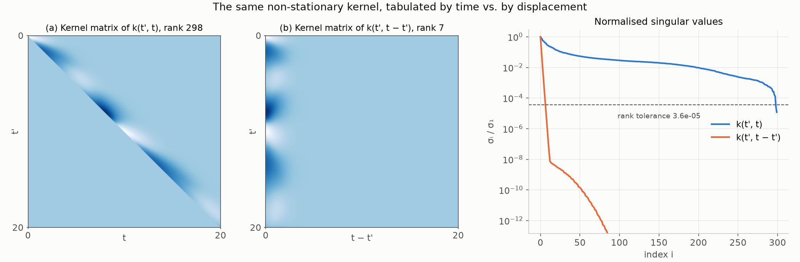
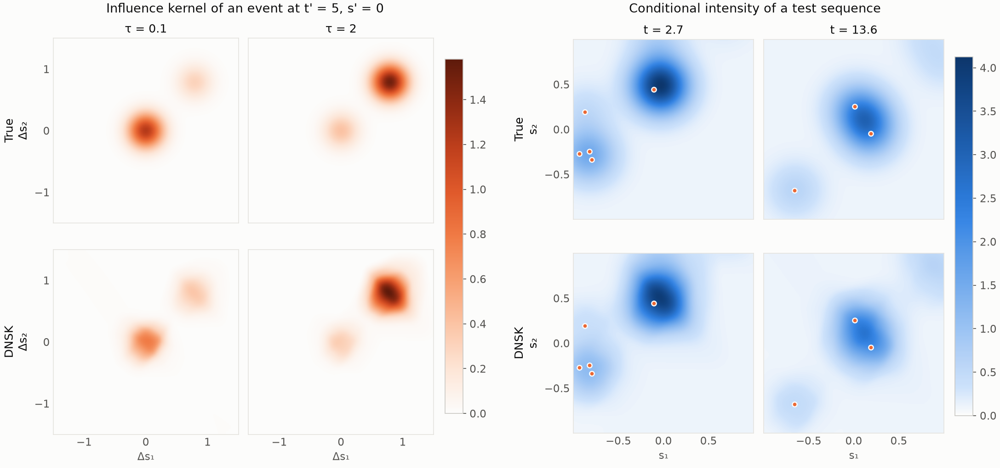
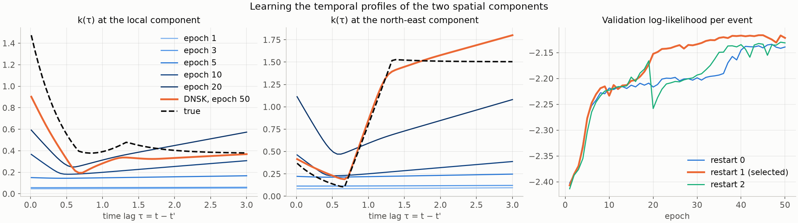
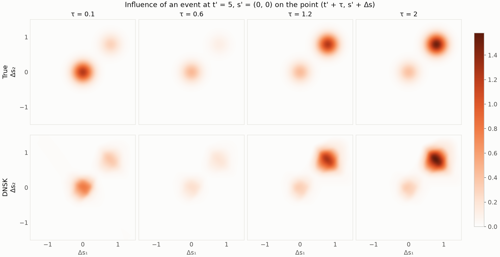
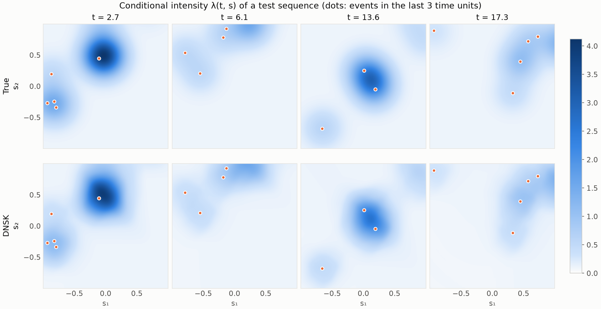

# DNSK: Spatio-Temporal Point Processes with Deep Non-Stationary Kernels

PyTorch implementation of **DNSK** from *Spatio-Temporal Point Processes with Deep Non-Stationary Kernels* (Zheng Dong, Xiuyuan Cheng, Yao Xie; ICLR 2023).

DNSK models event data in continuous time and space, such as earthquakes, crimes or disease cases, whose triggering effects change over time and location. The influence of past events is a neural low-rank kernel expressed in terms of the **displacement** between events. That form represents non-stationary kernels with a few basis functions, fits in $O(n)$ network evaluations per sequence, and can capture inhibition as well as excitation.

## Model

The conditional intensity is a background rate plus the influence of all past events,

$$\lambda(t, s) = \mu + \sum_{(t_i, s_i):\, t_i < t} k(t_i, t - t_i, s_i, s - s_i),$$

with the influence kernel decomposed into neural-network basis functions of the event time $t'$, the event location $s'$ and the displacements $t - t'$, $s - s'$ (Eq. 4):

$$k(t', t - t', s', s - s') = \sum_{r=1}^{R} \sum_{l=1}^{L} \alpha_{lr}\, \psi_l(t')\, \phi_l(t - t')\, u_r(s')\, v_r(s - s').$$

- **Displacement makes non-stationary kernels low-rank.** Below, the same kernel tabulated as $k(t', t)$ has numerical rank 298 (of 300), but only rank 7 as $k(t', t - t')$, so a few basis functions suffice.
- **Inhibition is allowed.** The basis networks have linear outputs, so $k$ may be negative. Non-negativity of $\lambda$ is encouraged by a **log-barrier** on a grid instead of a non-linear link, which keeps $\lambda$ linear in the kernel.
- **Efficient likelihood.** Linearity splits the integral of $\lambda$ into one-dimensional integrals of the basis functions (Eq. 8). $\phi_l$ is evaluated only on a grid, and $v_r$ only on event pairs inside its local support $[0, \tau_{\max}] \times B(0, s_{\max})$.

[](assets/displacement_rank.png)

## Results

We simulate 1,000 sequences (about 16 events each) from the non-stationary mixture kernel of the paper's synthetic "3D Data set 2". The kernel has two spatial components: a local one that excites immediately, and one shifted to the north-east that excites with a delay. Both fade with the event time $t'$ and are weaker for events in the north. DNSK with $L = R = 2$ is trained on 800 sequences, with three restarts of 50 epochs each (about 8 minutes on a laptop CPU), keeping the restart with the best validation likelihood.

[](assets/comparison.png)

*Left: influence of an event at $t' = 5$, $s' = 0$ as a function of the spatial displacement, shortly after the event ($\tau = 0.1$) and later ($\tau = 2$). DNSK recovers the hand-over from the local to the north-east component. Right: conditional intensity of a held-out sequence at two times; dots are events of the last 3 time units.*

| Test set (100 sequences) | Log-likelihood per event | Intensity MRE |
| --- | --- | --- |
| True model | −2.034 | — |
| DNSK | −2.048 | 0.064 |

[](assets/training_progress.png)

*Training progress. The learned temporal profile $k(\tau)$ at the centre of each spatial component moves towards the truth over the epochs; orange is the final model. Right: validation likelihood of the three restarts. Restarts that settle in a worse local optimum have a lower validation likelihood, which is how `fit_restarts` picks the model.*

<details>
<summary>More snapshots of the kernel and the intensity</summary>

[](assets/kernel_recovery.png)

[](assets/intensity_recovery.png)

</details>

All figures come from [`examples/synthetic_spatiotemporal.py`](examples/synthetic_spatiotemporal.py).

## Installation

```bash
git clone https://github.com/McDaniel7/STPP-Deep-Non-Stationary-Kernel-DNSK.git && cd STPP-Deep-Non-Stationary-Kernel-DNSK
pip install -e .            # core: numpy, torch
pip install -e ".[examples]"  # + matplotlib for the examples
```

## Usage

```python
import numpy as np
import torch
import dnsk

# Event sequences: arrays of shape [n_i, 1 + d] with columns (t, x, y), sorted by time.
# Here we simulate some from a simple stationary kernel; use your own data instead.
def kernel(t_hist, s_hist, t, s):
    d2 = np.sum((s - s_hist) ** 2, axis=-1)
    return 0.5 * np.exp(-2 * (t - t_hist)) * np.exp(-d2 / 0.08) / (0.08 * np.pi)

sequences = dnsk.simulate(kernel, mu=0.1, T=(0, 20), S=[(-1, 1), (-1, 1)],
                          upper_bound=10.0, n_sequences=200, rng=np.random.default_rng(0))
X, mask = dnsk.pad_sequences(sequences, T=(0, 20))

model = dnsk.DNSK(
    T=(0, 20), S=[(-1, 1), (-1, 1)],   # observation window and spatial domain
    mu=0.1,                            # background rate (fixed; learn_mu=True to learn it)
    tau_max=3.0, s_max=1.0,            # temporal / spatial range of influence
    n_basis_time=1, n_basis_space=1,   # ranks L and R
)
history = dnsk.fit(model, X, mask, dnsk.TrainConfig(epochs=20))
# or: model, histories, best = dnsk.fit_restarts(build_model, X_train, mask_train, X_val, mask_val, config)

loglik = model.log_likelihood(X, mask)                          # [B] per-sequence log-likelihood
t_grid = torch.linspace(0, 20, 50)
s_grid = torch.cartesian_prod(torch.linspace(-1, 1, 30), torch.linspace(-1, 1, 30))
lam = model.intensity(X, mask, t_grid, s_grid)                  # [B, 50, 900] intensity on a grid
k = model.kernel(torch.tensor(5.0), torch.tensor(5.5),          # k(t'=5, s'=0 -> t=5.5, s)
                 torch.zeros(2), s_grid)                        # [900]
t_next, s_next = dnsk.predict_next_event(model, X, mask)        # expected next event time / location
model.save("model.pt"); model = dnsk.DNSK.load("model.pt")
```

For temporal data, pass `S=None` and give each sequence as a 1-D array of times. The kernel is then $k(t', t-t') = \sum_l \alpha_l \psi_l(t')\phi_l(t-t')$.

## Examples

| Script | What it shows |
| --- | --- |
| `examples/displacement_rank.py` | The low-rank figure in [Model](#model). |
| `examples/synthetic_spatiotemporal.py` | Everything in [Results](#results): simulation by thinning, training with the log-barrier and restarts, evaluation against the true model, and the figures. |

```bash
python examples/displacement_rank.py --out assets/displacement_rank.png
python examples/synthetic_spatiotemporal.py --out results/example   # ~8 min on a laptop CPU (3 restarts x 50 epochs)
python examples/synthetic_spatiotemporal.py --out results/example --plot-only   # redraw the figures
python examples/synthetic_spatiotemporal.py --out results/example --plot-only --style iclr   # colours of the paper
```

To simulate from your own kernel, write a NumPy function `kernel(t_hist, s_hist, t, s)` that broadcasts over leading dimensions and pass it to `dnsk.simulate`. The example script shows one.

## Paper-to-code map

| Paper | Code |
| --- | --- |
| Kernel, Eq. (4) | `dnsk.kernel.DNSKKernel` (`psi`, `phi`, `u`, `v`, `alpha`) |
| Basis networks (2 hidden layers, Softplus, linear output) | `dnsk.basis.BasisBank` |
| Conditional intensity, Eq. (3) | `DNSK.event_intensity`, `DNSK.intensity` |
| Log-likelihood, Eq. (2); log-summation, Eq. (7) | `DNSK.log_likelihood`, `DNSK.event_intensity` |
| Integral decomposition, Eq. (8), and grid computation (App. A.3) | `DNSK.compensator`, `dnsk._grid` |
| Log-barrier, Eqs. (5)–(6); Algorithm 1 | `DNSK.barrier_intensity`, `dnsk.training.fit` |
| Thinning, Algorithm 2 | `dnsk.simulation.simulate` |
| Next-event prediction (Sec. 5.2) | `dnsk.prediction.predict_next_event` |

## Data format and conventions

- `X` has shape `[B, N, 1 + d]` with time in column 0 and location in columns `1..d`. It is zero-padded; `mask` (`[B, N]`, bool) marks real events. `pad_sequences` builds both and checks ordering and the window.
- `mu` is a rate per unit time and unit area. Rescale space (for example to `[-1, 1]^d`) and time to O(1) ranges before fitting. This keeps the grids and `s_max` meaningful.
- Basis-network inputs are rescaled internally: $t'$ to $[0,1]$ over the window, $t - t'$ to $[0,1]$ over $[0, \tau_{\max}]$, $s'$ to $[-1,1]^d$ over $S$, and $s - s'$ to the unit ball.

## Choosing hyper-parameters

| Parameter | Meaning | Guidance |
| --- | --- | --- |
| `tau_max`, `s_max` | support of $\phi_l$ and $v_r$ | Use the largest lag/distance at which events plausibly interact. A larger support costs more pairs to evaluate. The paper uses $\tau_{\max} \approx T/4$ for real data. |
| `n_basis_time`, `n_basis_space` | ranks $L$, $R$ | Small values (1–3) are usually enough thanks to the displacement form. Choose by validation likelihood. |
| `fit_restarts(..., n_restarts)` | number of random initialisations | With $L, R > 1$ the likelihood has local optima (for example, temporal profiles assigned to the wrong spatial component). Train 3–5 restarts and keep the best validation likelihood. |
| `n_grid_time` | $\lvert U_t\rvert$, grid for $\phi_l$ | 50 is accurate for smooth $\phi_l$ (App. A.3). |
| `n_grid_space` | points per dimension for integrating $v_r$ | 50 per dimension. |
| `n_barrier_time`, `n_barrier_space` | barrier grid $U_{\mathrm{bar},t} \times U_{\mathrm{bar},s}$ | Denser grids enforce $\lambda \ge 0$ more tightly but cost more. The spatial barrier usually dominates the run time. |
| `TrainConfig.t_init`, `t_mul`, `t_max` | barrier weight $1/t$ and its schedule | The weight decays as $t \leftarrow \min(t \cdot t_{\mathrm{mul}}, t_{\max})$. |
| `TrainConfig.margin`, `b_max` | lower bound $b$ of the barrier | Defaults: $\mu/4$ and $-\mu/2$. |

As in Algorithm 1, the bound $b$ follows the smallest grid intensity, $b = \min \lambda - \epsilon$, so the logarithm is always defined. The barrier is therefore a penalty that pushes the intensity away from negative values on $U_{\mathrm{bar}}$; it is not a hard constraint. In the likelihood, $\log \lambda$ at events is computed as $\log \max(\lambda, 10^{-5})$ (`log_eps`). Use `TrainConfig(seed=...)` and `torch.manual_seed` before building the model to make runs reproducible.

## Implementation notes

This package is a clean re-implementation of the original research code. The model and the estimator are the same, with these deliberate differences:

- **Initialization.** Each basis network starts close to the constant 1 (output bias 1), and $\alpha$ is set so that the initial kernel has a small branching ratio (`init_branching=0.1`), with a random factor per component to break their symmetry. With small random outputs, the product $\psi\phi u v$ and its gradients start near zero, and training stalls.
- **Restarts.** `fit_restarts` trains several initialisations and keeps the best validation likelihood.
- **Optimizer.** The default is Adam (lr `1e-2`), as described in the paper. The research code used Adadelta, which is still available as `TrainConfig(optimizer="adadelta")`.
- **Integrals.** $F_l(x) = \int_0^x \phi_l$ is the exact integral of the linear interpolant of $\phi_l$ on $U_t$. The truncated spatial integrals $\int_{B(0, s_{\max}) \cap (S - s_i)} v_r$ come from a summed-area table over a midpoint grid, which is $O(1)$ per event.
- **Barrier grid.** The spatial barrier points form a regular midpoint grid over $S$ instead of random uniform points.
- **Scope.** Only the unmarked kernel of Eq. (4) is implemented. The mark extension of Appendix B is not.

## Tests

```bash
pip install -e ".[dev]"
pytest
```

The tests check every efficient likelihood term (event intensities, the temporal and spatial integrals, and the barrier-grid intensities) against brute-force evaluation. They also check the exact Poisson limit, the simulator against known moments, next-event prediction against a closed form, and that training improves held-out likelihood.

## Citation

```bibtex
@inproceedings{dong2023spatio,
  title     = {Spatio-Temporal Point Processes with Deep Non-Stationary Kernels},
  author    = {Dong, Zheng and Cheng, Xiuyuan and Xie, Yao},
  booktitle = {International Conference on Learning Representations},
  year      = {2023}
}
```

## License

MIT, see [LICENSE](LICENSE).
